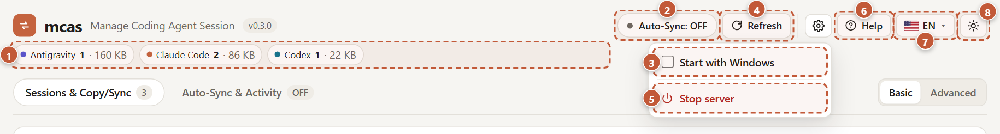
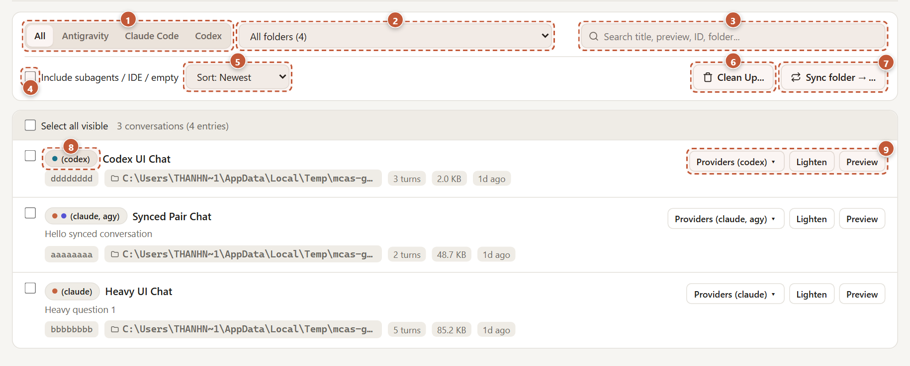
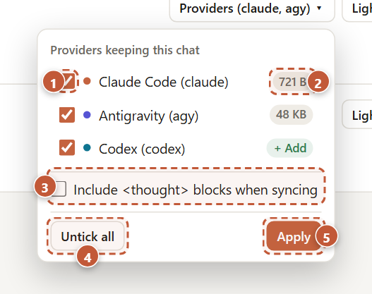
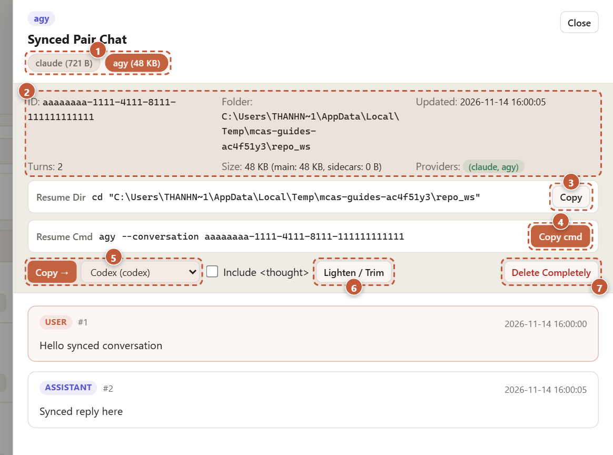
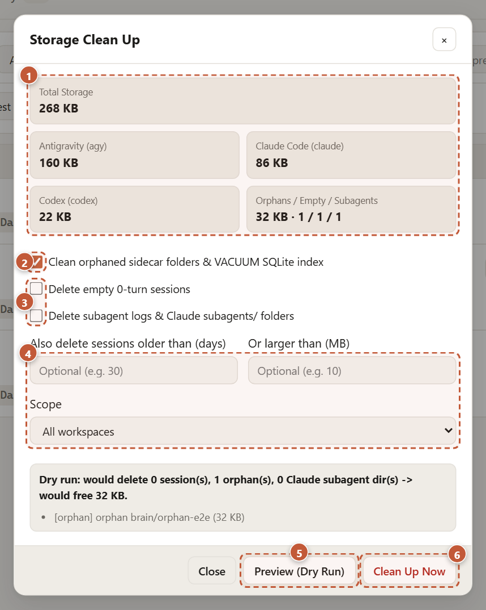
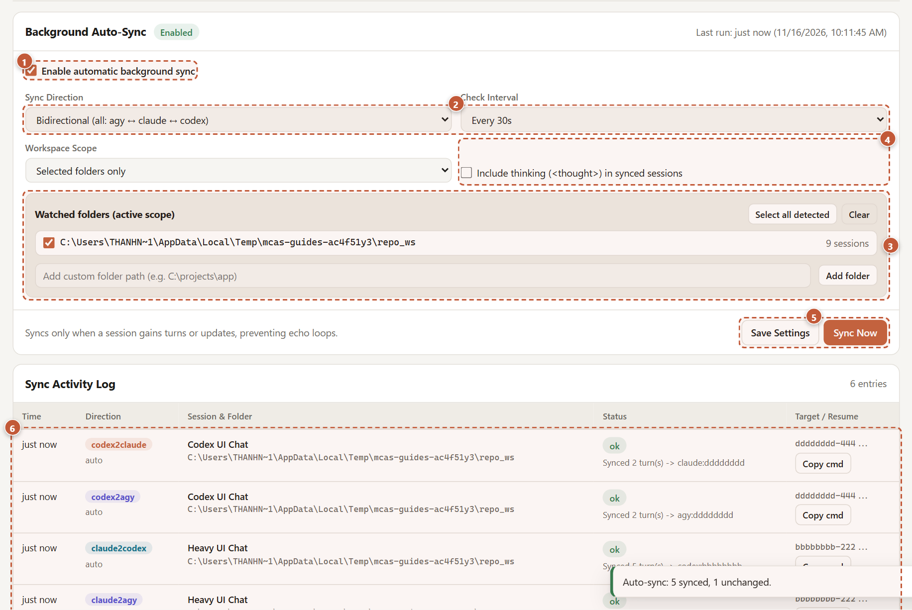

# `mcas` Web UI Guide

An illustrated guide explaining each control, Basic vs Advanced mode behavior, and common workflows in the **`mcas`** (Manage Coding Agent Session) Web UI.

> **Quick in-app tip:** Click **`? Help`** in the top-right utility bar (or press **`?`**) to open this annotated visual guide directly inside the Web UI, switch between **Basic** (default) and **Advanced** using the toggle on the right of the tab bar, or use the **`EN / VI`** flag dropdown to switch UI languages anytime.

## Interface Modes: Basic (Default) vs Advanced

`mcas` defaults to **Basic** mode (`mcas.uiMode` in `localStorage`) so daily workflows—browsing, searching, previewing, syncing/copying, **Lighten**, and **Clean Up**—stay clutter-free with safe defaults.

- **Basic mode (default):** Hides rarely needed power options (such as `#includeAll`, custom folder paths, bulk folder overrides/UUID forcing, `<thought>` toggles, custom age/size cleanup thresholds, and Auto-Sync interval/watched-folder lists). Hidden one-shot options automatically use safe defaults without erasing any saved preferences.
- **Advanced mode:** Click **Advanced** in `#uiModeSwitch` (right side of the tab bar) to reveal all power controls marked **[Advanced]** below. Any non-default Advanced filters or Auto-Sync settings remain clearly summarized in Basic mode via dismissible filter chips or a read-only Auto-Sync summary with an **Edit in Advanced** shortcut.

## Table of Contents

1. [Top Bar & Global Controls](#1-top-bar--global-controls)
2. [Filters, Bulk Actions & Session Rows](#2-filters-bulk-actions--session-rows)
3. [Per-Session Provider Sync & Removal Dropdown](#3-per-session-provider-sync--removal-dropdown)
4. [Preview Slide-Over Drawer](#4-preview-slide-over-drawer)
5. [Lighten / Trim Modal](#5-lighten--trim-modal)
6. [Storage Clean Up Modal](#6-storage-clean-up-modal)
7. [Background Auto-Sync & Activity Log](#7-background-auto-sync--activity-log)
8. [Real-World Use Cases](#8-real-world-use-cases)

---

## 1. Top Bar & Global Controls

| # | Control | Description | When to use |
|---|---|---|---|
| **1** | **Provider chips** (`#providerChips`) | Live conversation count and disk footprint for each active coding agent (`Antigravity`, `Claude Code`, `Codex`). | Click any chip to quickly filter the list to that provider. |
| **2** | **Auto-Sync pill** (`#autosyncPill`) | Shows whether background Auto-Sync is **ON** (with polling interval), **OFF**, or actively **syncing**. | Click to jump straight to the **Auto-Sync & Activity** tab. |
| **3** | **Start with Windows** (inside **Settings** `#settingsBtn`) | Creates or removes the `mcas` system tray shortcut in the Windows Startup folder. | Enable inside the Settings gear menu if you want background Auto-Sync to start automatically on sign-in. |
| **4** | **Refresh** (`#refreshBtn`) | Forces an immediate rescan of provider storage and reloads sessions. | Use right after finishing a CLI chat without waiting for the 5-second auto-refresh. |
| **5** | **Stop server** (inside **Settings** `#settingsBtn`) | Safely shuts down the local web server, Auto-Sync loop, and Windows tray icon (with confirmation dialog). | Use before upgrading `mcas` or when shutting down background services cleanly. |
| **6** | **Help** (`#helpBtn`) | Opens the interactive Visual UI Guide & FAQ modal (keyboard shortcut: **`?`**). | Press `?` anytime to inspect controls without leaving the Web UI. |
| **7** | **Language** (`#langBtn`) | Flag dropdown (**EN / VI**) switching the entire UI live between **English** and **Tiếng Việt** (`localStorage`). | Switch UI language anytime; CLI resume commands (`claude --resume ...`, `agy --conversation ...`, `codex resume ...`) stay unchanged. |
| **8** | **Theme toggle** (`#themeBtn`) | Top-right button switching between **Light** and **Dark** color themes (`mcas.theme`). | Override color theme manually regardless of Windows theme settings. |

---

## 2. Filters, Bulk Actions & Session Rows

| # | Control | Description | When to use |
|---|---|---|---|
| **1** | **Provider filter** (`#providerPills`) | Segmented switch for **All / Antigravity / Claude Code / Codex**. | Narrow the list to sessions belonging to one coding agent. |
| **2** | **Workspace folder** (`#cwdSelect`) | Dropdown filtering by detected repository paths (**[Advanced]** adds a **Custom folder path...** input `#cwdCustomWrap`). | Focus only on conversations for the repository you are currently working on. |
| **3** | **Search** (`#searchInput`) | Instant filter by conversation title, message preview, session UUID, or folder path. | Locate an older conversation by keyword or paste a partial/full UUID. |
| **4** | **Include subagents / IDE / empty** (`#includeAll`) **[Advanced]** | Reveals subagent logs, IDE chats, and 0-turn empty sessions (hidden by default; shows a dismissible filter chip if active). | Turn on when auditing storage bloat or inspecting background subagent logs. |
| **5** | **Sort order** (`#sortSelect`) | Orders sessions by **Newest**, **Largest size**, **Most turns**, or **Oldest**. | Pick **Sort: Largest size** to spot bloated conversations ready to lighten. |
| **6** | **Clean Up...** (`#openCleanupBtn`) | Opens the **Storage Clean Up** modal (orphaned sidecars, empty sessions, subagent traces, SQLite `VACUUM`). | Run periodically with **Dry Run** preview to reclaim disk space safely. |
| **7** | **Sync folder** (`#openSyncDirBtn`) | Bulk-copies top-level sessions for a workspace from one provider to another. In **Basic** mode, appears as **Sync this folder → ...** whenever a workspace folder filter is active; always visible in **Advanced** mode (along with target override, `<thought>`, and overwrite options). | Migrate an entire project's conversation history between `agy`, `claude`, and `codex`. |
| **8** | **Provider tag** (`.prov-tag-btn`) | Indicates where the conversation exists, e.g. `(claude, agy, codex)` when synced across providers, or `(claude)` / `(agy)` / `(codex)`. | Click to open the sync/removal dropdown for that session. |
| **9** | **Row actions** (`.row-actions`) | Quick buttons: **Providers**, **Lighten** (in-place trim), and **Preview** (slide-over drawer). **[Advanced]** also displays the clickable session ID chip on each row. | Click **Lighten** on heavy sessions or **Preview** to read turns and copy resume commands. |

> **Bulk Selection Bar (`#selectionBar`):** Selecting one or more rows reveals an orange action bar showing total selected size alongside **Copy Selected** and **Delete Selected**. Switching to **Advanced** mode adds **Include `<thought>`** (`#bulkThinking`) and the **Options** menu (`#bulkOptionsBtn`) for target folder overrides, forcing a new UUID, and overwriting existing copies.

---

## 3. Per-Session Provider Sync & Removal Dropdown

| # | Control | Description | When to use |
|---|---|---|---|
| **1** | **Provider checkboxes** | Checked means a copy exists on that provider (`claude` / `agy` / `codex`); unchecked means absent. | Tick a missing provider to copy/sync there; untick an existing provider to remove only that side. |
| **2** | **Size & pending badges** | Shows current storage size (e.g., `186 KB`), or pending **`+ Add`** / **`- Remove`** badges. | Verify exact changes before clicking **Apply**. |
| **3** | **Include `<thought>`** (`.prov-dd-opts`) **[Advanced]** | Appears when adding a provider in **Advanced** mode; folds internal reasoning blocks into the copied transcript. | Enable when you want the target agent to inherit detailed reasoning steps. |
| **4** | **Untick all** | Unchecks every provider at once and switches **Apply** into full-delete mode. | Quick shortcut to remove a conversation from every provider. |
| **5** | **Apply / Apply (Delete)** | Executes pending additions/removals; unchecking all providers always prompts for delete confirmation. | Click after verifying the `+ Add` / `- Remove` badges look right. |

---

## 4. Preview Slide-Over Drawer

| # | Control | Description | When to use |
|---|---|---|---|
| **1** | **Provider tabs** (`#drawerProvTabs`) | Appears on paired sessions (e.g., `claude (1.9 KB)`, `agy (48 KB)`, `codex (12 KB)`), switching between copies in place. | Compare file sizes or inspect turns/IDs across providers. |
| **2** | **Metadata & size breakdown** (`#drawerMetaGrid`) | Displays full UUID, workspace folder, updated timestamp, turn count, and **main vs sidecar** byte breakdown. | Check whether bloat comes from the main transcript or sidecars (`brain` / `subagents`). |
| **3** | **Copy Resume Dir** (`#drawerCopyDir`) | Copies `cd "<workspace>"` for the session's working directory. | Paste into a new terminal before running the resume command (important for `claude --resume` and `codex resume`). |
| **4** | **Copy Resume Cmd** (`#drawerCopyCmd`) | Copies `claude --resume <id>`, `agy --conversation <id>`, or `codex resume <id>`. | Resume this exact conversation in your CLI terminal immediately. |
| **5** | **Copy to target provider** (`#drawerCopyBtn`, `#drawerCopyTarget`) | Pick a target provider and copy in one click (**[Advanced]** exposes **Include `<thought>`** `#drawerThinking`). | Hand off an active chat mid-task to another coding agent. |
| **6** | **Lighten / Trim** (`#drawerTrimBtn`) | Opens **Lighten Conversation** for this session group. | Shrink bloated logs and sidecar files by several MB. |
| **7** | **Delete Completely** (`#drawerDeleteBtn`) | Permanently removes all provider copies in the group after confirmation. | Remove finished or throwaway sessions across all providers at once. |

---

## 5. Lighten / Trim Modal

| # | Control | Description | When to use |
|---|---|---|---|
| **1** | **History turns to keep** (`#tmKeepPreset`) | Keep **newest 50%** (recommended), **last 20/50 turns**, or **all turns**. | Pick **Keep all turns** to strip heavy sidecars/tool dumps without dropping any messages. |
| **2** | **Purge heavy sidecars** (`#tmPurgeSidecars`) **[Advanced]** | Deletes `brain/` images/logs, `subagents/` folders, and `file-history` backups (enabled automatically in **Basic** mode). | Typically saves **80–95%** of session bytes while keeping the main conversation intact. |
| **3** | **Truncate tools & Strip `<thought>`** (`#tmTruncateTools`, `#tmStripThinking`) **[Advanced]** | Caps tool outputs longer than 2,000 characters and strips internal thinking blocks (enabled automatically in **Basic** mode). | Useful to toggle off in **Advanced** mode if you want to preserve raw tool dumps or reasoning blocks. |
| **4** | **Lighten Now** (`#tmSubmitBtn`) | Trims all provider copies in the session group in place and reports freed bytes. | Click to slim the conversation immediately. |

---

## 6. Storage Clean Up Modal

| # | Control | Description | When to use |
|---|---|---|---|
| **1** | **Storage breakdown** (`#clStorageGrid`) | Displays total usage, `agy` / `claude` / `codex` disk usage, and **Orphans / Empty / Subagents** counts. | Check at a glance how much reclaimable space is available. |
| **2** | **Orphaned sidecars & SQLite VACUUM** (`#clOrphans`) | Removes orphaned `brain`/sidecar directories whose sessions no longer exist and compacts SQLite indexes (`VACUUM`). | Safe to keep checked on every cleanup run. |
| **3** | **Empty sessions & Subagents** (`#clEmpty`, `#clSubagents`) | Deletes 0-turn empty sessions and subagent logs/`subagents/` directories. | Check to clear accidental empty launches or leftover subagent traces. |
| **4** | **Age / Size filters & Scope** (`#clOlderDays`, `#clLargerMb`, `#clScope`) **[Advanced]** | Optional filters to target sessions older than N days or larger than N MB, across **All workspaces** or the active workspace filter only. | Use in **Advanced** mode for targeted pruning of stale or oversized conversations. |
| **5** | **Preview (Dry Run)** (`#clPreviewBtn`) | Scans and lists every matching target and estimated freed bytes **without deleting anything**. | **Always run Dry Run first** before confirming permanent deletion. |
| **6** | **Clean Up Now** (`#clRunBtn`) | Prompts for final confirmation and permanently removes matched items. | Click after reviewing the Dry Run list. |

---

## 7. Background Auto-Sync & Activity Log

| # | Control | Description | When to use |
|---|---|---|---|
| **1** | **Enable Auto-Sync** (`#asEnabled`) | Toggles periodic background syncing on or off. | Enable when using Antigravity, Claude Code, and Codex side by side every day. |
| **2** | **Direction & Interval** (`#asDirection`, `#asInterval`) | Choose **Bidirectional (all: `agy ↔ claude ↔ codex`)**, a pair-specific bidirectional route (e.g., `agy ↔ codex`), or a 1-way route. Polling interval (`10s–300s`, default `30s`) is configurable in **[Advanced]** mode. | **Bidirectional + 30s** keeps new turns synced smoothly across agents without echo loops. |
| **3** | **Workspace Scope & Watched Folders** (`#asScope`, `#watchedBox`) **[Advanced]** | Restrict Auto-Sync to **Selected folders only** with checkboxes and custom folder paths (defaults to **All workspaces**; summarized in **Basic** mode with **Edit in Advanced** if customized). | Use **Selected folders only** when you want background sync limited to specific repositories. |
| **4** | **Include `<thought>`** (`#asIncludeThinking`) **[Advanced]** | Controls whether internal `<thought>` blocks are preserved during Auto-Sync. | Leave off for smaller synced files; enable if you review reasoning blocks across agents. |
| **5** | **Save Settings & Sync Now** (`#asSaveBtn`, `#asSyncNowBtn`) | **Save Settings** writes config to `sync_state.json` (enabled when changes are unsaved); **Sync Now** (or **Save & Sync Now** when dirty) runs a sync pass immediately. | Save changes or trigger an instant check anytime. |
| **6** | **Sync Activity Log** (`#historyBody`) | Newest-first log showing timestamp, direction (`auto` / `manual`), status, and a one-click **Copy cmd** button. | Grab the target CLI resume command or inspect skipped/failed entries. |

---

## 8. Real-World Use Cases

1. **Switch coding agent mid-task (quota hit or second opinion):**
   - Open the `mcas` Web UI, find your active session, and click its **Provider** tag (or **Preview → Copy →** after selecting the target provider).
   - Inside **Preview**, click **Copy** next to *Resume Dir* and **Copy cmd** next to *Resume Cmd*, then paste into your terminal to continue seamlessly (`claude --resume`, `agy --conversation`, or `codex resume`).
2. **Automatically sync only selected repositories in the background:**
   - Switch to **Advanced** mode and open **Auto-Sync & Activity** → enable **Enable automatic background sync** → choose **Bidirectional (all)** or a specific pair/1-way direction → set **Workspace Scope** to **Selected folders only** → check your target repositories → click **Save Settings**.
   - The ledger in `sync_state.json` tracks `(mtime_ns, turn_count)` per side so syncs only fire on new updates and never echo-loop.
3. **Slim down a multi-megabyte session bloated by images or subagents:**
   - Choose **Sort: Largest size** → click **Lighten** on the heaviest row → choose **Keep all turns** if you want 100% of conversation turns preserved (Basic mode automatically purges heavy sidecars, truncates large tool outputs, and strips thinking blocks; customize in **Advanced** if needed) → click **Lighten Now**.
4. **Remove a copy from just one provider vs delete everywhere:**
   - **Single provider:** Click the row's **Provider** tag → uncheck only the provider you want to remove → click **Apply**.
   - **Everywhere:** Click the row's **Provider** tag → click **Untick all** → click **Apply (Delete)** and confirm.
