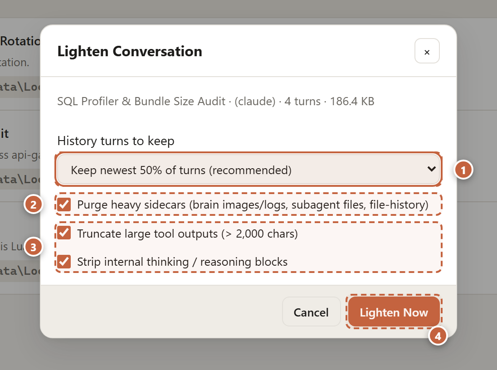

# Hướng dẫn Giao diện Web (`mcas` Web UI Guide)

Tài liệu trực quan giải thích từng nút điều khiển và các quy trình sử dụng thực tế trên Web UI của **`mcas`** (Manage Coding Agent Session).

> **Mẹo nhanh ngay trong ứng dụng:** Bấm nút **`? Help`** ở góc trên bên phải (hoặc nhấn phím **`?`**) để mở bảng hướng dẫn trực quan ngay trong giao diện web, và dùng nút cờ **`EN / VI`** để chuyển đổi ngôn ngữ giữa Tiếng Việt và English bất kỳ lúc nào.

## Mục lục

1. [Thanh tiêu đề & Điều khiển chung](#1-thanh-tiêu-đề--điều-khiển-chung)
2. [Bộ lọc, Thao tác hàng loạt & Dòng phiên](#2-bộ-lọc-thao-tác-hàng-loạt--dòng-phiên)
3. [Menu Đồng bộ & Gỡ Provider trên từng phiên](#3-menu-đồng-bộ--gỡ-provider-trên-từng-phiên)
4. [Ngăn Xem trước chi tiết phiên (Preview Drawer)](#4-ngăn-xem-trước-chi-tiết-phiên-preview-drawer)
5. [Hộp thoại Làm nhẹ / Cắt gọn phiên (Lighten)](#5-hộp-thoại-làm-nhẹ--cắt-gọn-phiên-lighten)
6. [Hộp thoại Dọn dẹp dung lượng (Storage Clean Up)](#6-hộp-thoại-dọn-dẹp-dung-lượng-storage-clean-up)
7. [Auto-Sync chạy nền & Nhật ký hoạt động](#7-auto-sync-chạy-nền--nhật-ký-hoạt-động)
8. [Các tình huống sử dụng thực tế](#8-các-tình-huống-sử-dụng-thực-tế)

---

## 1. Thanh tiêu đề & Điều khiển chung

| Số | Thành phần | Mô tả ngắn | Trường hợp sử dụng |
|---|---|---|---|
| **1** | **Thẻ Provider** (`#providerChips`) | Hiển thị số lượng phiên và tổng dung lượng đĩa của từng coding agent (`agy`, `claude`; `opencode`/`codex` đang ở trạng thái `SOON`). | Bấm trực tiếp vào thẻ **Antigravity** hoặc **Claude Code** để lọc nhanh danh sách phiên của agent đó. |
| **2** | **Nút trạng thái Auto-Sync** (`#autosyncPill`) | Cho biết Auto-Sync nền đang **ON** (kèm chu kỳ giây), **OFF**, hoặc đang đồng bộ. | Bấm để chuyển thẳng sang tab **Auto-Sync & Activity** cấu hình hoặc xem nhật ký. |
| **3** | **Khởi động cùng Windows** (`#autostartWrap`) | Tạo hoặc gỡ shortcut khay hệ thống `mcas` trong thư mục Startup của Windows. | Bật nếu muốn dịch vụ nền & Auto-Sync tự chạy mỗi khi đăng nhập Windows. |
| **4** | **Làm mới** (`#refreshBtn`) | Quét lại ngay dữ liệu phiên trên ổ đĩa và cập nhật danh sách. | Dùng ngay sau khi vừa kết thúc một cuộc chat trên CLI mà chưa muốn đợi chu kỳ tự động 5 giây. |
| **5** | **Dừng máy chủ** (`#quitBtn`) | Tắt an toàn web server cục bộ, luồng Auto-Sync và biểu tượng khay hệ thống (có hộp thoại xác nhận). | Dùng trước khi cập nhật phiên bản `mcas` hoặc khi muốn tắt hẳn tiến trình nền. |
| **6** | **Hướng dẫn** (`#helpBtn`) | Mở hộp thoại Visual Help / FAQ có ảnh chú thích ngay trong ứng dụng (phím tắt **`?`**). | Nhấn `?` bất cứ lúc nào để tra cứu ý nghĩa nút bấm mà không cần rời giao diện web. |
| **7** | **Ngôn ngữ** (`#langBtn`) | Dropdown lá cờ **US / VN** chuyển đổi tức thì toàn bộ UI giữa **English** và **Tiếng Việt**, tự lưu vào `localStorage`. | Chuyển ngôn ngữ hiển thị theo sở thích; các lệnh CLI (`claude --resume ...`, `agy --conversation ...`) luôn giữ nguyên. |
| **8** | **Giao diện Sáng/Tối** (`#themeBtn`) | Nút góc trên cùng bên phải để chuyển đổi chế độ **Light / Dark** (`mcas.theme`). | Đổi tông màu Sáng/Tối thủ công bất kể cấu hình giao diện của Windows. |

---

## 2. Bộ lọc, Thao tác hàng loạt & Dòng phiên

| Số | Thành phần | Mô tả ngắn | Trường hợp sử dụng |
|---|---|---|---|
| **1** | **Bộ lọc Provider** (`#providerPills`) | Nhóm nút chuyển **All / Antigravity / Claude Code**. | Khi chỉ muốn xem danh sách phiên thuộc một agent cụ thể. |
| **2** | **Thư mục dự án** (`#cwdSelect`) | Dropdown lọc phiên theo đường dẫn workspace tự phát hiện (hoặc chọn nhập đường dẫn tùy chỉnh). | Tập trung đúng các cuộc hội thoại thuộc repository bạn đang code. |
| **3** | **Tìm kiếm** (`#searchInput`) | Tìm tức thì theo tiêu đề, đoạn xem trước, UUID phiên hoặc đường dẫn thư mục. | Tìm lại cuộc trò chuyện cũ theo từ khóa hoặc dán trực tiếp một đoạn UUID. |
| **4** | **Gồm subagent / IDE / trống** (`#includeAll`) | Hiện thêm các log subagent, phiên IDE và phiên trống 0 lượt (mặc định được ẩn để danh sách gọn). | Bật lên khi cần kiểm tra dung lượng rác hoặc tìm lại một phiên subagent chạy ngầm. |
| **5** | **Sắp xếp** (`#sortSelect`) | Sắp xếp theo **Mới nhất**, **Nặng nhất**, **Nhiều lượt nhất** hoặc **Cũ nhất**. | Chọn **Sort: Largest size** để phát hiện ngay các phiên nặng nhiều MB cần làm nhẹ. |
| **6** | **Dọn dẹp...** (`#openCleanupBtn`) | Mở hộp thoại **Storage Clean Up** (xóa file mồ côi, phiên trống, subagent, nén SQLite `VACUUM`). | Dùng định kỳ để giải phóng ổ đĩa một cách an toàn qua bước chạy thử Dry Run. |
| **7** | **Đồng bộ thư mục** (`#openSyncDirBtn`) | Sao chép hàng loạt toàn bộ phiên cấp cao nhất của một workspace từ provider này sang provider kia. | Khi muốn di chuyển toàn bộ lịch sử chat của một dự án từ `agy` sang `claude` (hoặc ngược lại). |
| **8** | **Thẻ Provider trên dòng** (`.prov-tag-btn`) | Cho biết phiên đang tồn tại ở đâu, ví dụ `(claude, agy)` khi hai bản đã ghép cặp đồng bộ, hoặc `(claude)` / `(agy)`. | Bấm vào thẻ để mở menu tích chọn đồng bộ sang bên còn lại hoặc gỡ riêng một bên. |
| **9** | **Thao tác nhanh trên dòng** (`.row-actions`) | Gồm nút **Providers**, **Lighten** (cắt gọn tại chỗ) và **Preview** (mở ngăn xem chi tiết). | Bấm **Lighten** với phiên quá nặng hoặc **Preview** để đọc lại nội dung và lấy lệnh resume. |

> **Thanh thao tác hàng loạt (`#selectionBar`):** Khi tích chọn từ 1 dòng trở lên (như dòng thứ 2 trong ảnh), thanh cam phía trên danh sách sẽ hiện tổng dung lượng đã chọn cùng nút **Copy Selected** và **Delete Selected** (hỗ trợ ghi đè thư mục đích, kèm `<thought>`, tạo UUID mới hoặc ghi đè bản có sẵn).

---

## 3. Menu Đồng bộ & Gỡ Provider trên từng phiên

| Số | Thành phần | Mô tả ngắn | Trường hợp sử dụng |
|---|---|---|---|
| **1** | **Ô chọn Provider** | Ô đã tích nghĩa là phiên đang có bản lưu ở provider đó (`claude` / `agy`). | Tích thêm provider chưa có để **sao chép sang**; bỏ tích một provider đang có để **gỡ chỉ bản ở bên đó**. |
| **2** | **Nhãn dung lượng & trạng thái chờ** | Hiển thị dung lượng hiện tại (VD: `186 KB`), hoặc nhãn chờ **`+ Add`** / **`- Remove`**. | Kiểm tra chính xác bên nào sẽ được thêm hoặc gỡ trước khi bấm áp dụng. |
| **3** | **Kèm khối `<thought>`** (`.prov-dd-opts`) | Chỉ hiện khi bạn tích thêm một provider mới; giữ lại phần suy nghĩ nội bộ vào văn bản trả lời của bản đích. | Tích chọn khi muốn agent đích kế thừa đầy đủ mạch suy luận chi tiết của cuộc chat. |
| **4** | **Bỏ chọn hết** (`Untick all`) | Bỏ tích toàn bộ provider cùng lúc, chuyển menu sang chế độ xóa hoàn toàn. | Phím tắt nhanh để xóa cuộc hội thoại khỏi mọi provider thay vì bỏ tích từng dòng. |
| **5** | **Áp dụng** (`Apply` / `Apply (Delete)`) | Thực thi các thay đổi đã tích; nếu bỏ chọn hết sẽ luôn bật hộp thoại xác nhận xóa vĩnh viễn. | Bấm sau khi kiểm tra đúng các nhãn `+ Add` / `- Remove`. |

---

## 4. Ngăn Xem trước chi tiết phiên (Preview Drawer)

| Số | Thành phần | Mô tả ngắn | Trường hợp sử dụng |
|---|---|---|---|
| **1** | **Tab chuyển Provider** (`#drawerProvTabs`) | Hiện khi phiên đã ghép cặp nhiều bên (VD: `claude (1.9 KB)` và `agy (48 KB)`), cho phép chuyển xem từng bản. | So sánh dung lượng hoặc kiểm tra nội dung/ID tương ứng ở cả hai provider. |
| **2** | **Thông số & phân rã dung lượng** (`#drawerMetaGrid`) | Hiển thị đầy đủ UUID, thư mục workspace, thời gian cập nhật, số lượt và dung lượng **main vs sidecars**. | Xác định dung lượng nặng nằm ở file chat chính hay file phụ (`brain` / `subagents`). |
| **3** | **Chép thư mục Resume** (`#drawerCopyDir`) | Sao chép lệnh `cd "<workspace>"` đúng thư mục dự án của phiên. | Dán vào terminal mới trước khi chạy lệnh resume (đặc biệt quan trọng với `claude --resume`). |
| **4** | **Chép lệnh Resume** (`#drawerCopyCmd`) | Sao chép lệnh `claude --resume <id>` hoặc `agy --conversation <id>`. | Tiếp tục ngay cuộc hội thoại này trong terminal CLI. |
| **5** | **Chép sang provider đối diện** (`#drawerCopyBtn`) | Sao chép một chạm sang provider còn lại, tôn trọng ô tích **Include `<thought>`**. | Chuyển tiếp nhanh cuộc trò chuyện đang mở sang agent kia. |
| **6** | **Làm nhẹ / Cắt gọn** (`#drawerTrimBtn`) | Mở hộp thoại **Lighten Conversation** cho chính nhóm phiên đang xem. | Giảm dung lượng file chat và file phụ khi phiên phình to nhiều MB. |
| **7** | **Xóa hoàn toàn** (`#drawerDeleteBtn`) | Xóa vĩnh viễn mọi bản sao của phiên trên tất cả provider (luôn hỏi xác nhận trước). | Dọn bỏ hoàn toàn một phiên nháp hoặc tác vụ đã xong ở mọi nơi. |

---

## 5. Hộp thoại Làm nhẹ / Cắt gọn phiên (Lighten)

| Số | Thành phần | Mô tả ngắn | Trường hợp sử dụng |
|---|---|---|---|
| **1** | **Số lượt lịch sử giữ lại** (`#tmKeepPreset`) | Chọn giữ **50% lượt mới nhất**, **20/50 lượt cuối**, hoặc **Giữ tất cả lượt**. | Chọn **Keep all turns** nếu bạn chỉ muốn xóa log tool/ảnh nặng mà không mất bất kỳ tin nhắn nào. |
| **2** | **Xóa file phụ nặng** (`#tmPurgeSidecars`) | Xóa ảnh/log trong `brain/`, thư mục `subagents/` và `file-history` đi kèm. | Thường tiết kiệm **80–95%** dung lượng đĩa mà vẫn giữ nguyên nội dung hội thoại chính. |
| **3** | **Rút gọn tool & Xóa `<thought>`** (`#tmTruncateTools`, `#tmStripThinking`) | Cắt gọn kết quả tool quá dài (> 2.000 ký tự) và loại bỏ các khối suy nghĩ nội bộ. | Giữ tích cả hai khi phiên có nhiều đoạn dump file lớn hoặc chuỗi reasoning dài. |
| **4** | **Làm nhẹ ngay** (`#tmSubmitBtn`) | Thực thi cắt gọn trực tiếp tại chỗ trên tất cả các bản sao trong nhóm phiên. | Bấm để thu gọn dung lượng ngay và xem thông báo số KB/MB đã giải phóng. |

---

## 6. Hộp thoại Dọn dẹp dung lượng (Storage Clean Up)

| Số | Thành phần | Mô tả ngắn | Trường hợp sử dụng |
|---|---|---|---|
| **1** | **Bảng thống kê dung lượng** (`#clStorageGrid`) | Hiển thị tổng dung lượng, dung lượng của `agy` / `claude`, và bộ đếm **Orphans / Empty / Subagents**. | Kiểm tra nhanh xem có bao nhiêu MB rác có thể thu hồi an toàn. |
| **2** | **File mồ côi & nén SQLite** (`#clOrphans`) | Xóa các thư mục `brain` / sidecar không còn phiên gốc và chạy `VACUUM` nén cơ sở dữ liệu SQLite. | An toàn để luôn giữ tích trong mọi lần dọn dẹp. |
| **3** | **Phiên trống & Subagent** (`#clEmpty`, `#clSubagents`) | Xóa các phiên 0 lượt không có hội thoại và log/thư mục `subagents/`. | Tích chọn khi muốn dọn các phiên mở nhầm hoặc dấu vết subagent cũ. |
| **4** | **Ngưỡng Ngày / MB & Phạm vi** (`#clOlderDays`, `#clLargerMb`, `#clScope`) | Tùy chọn xóa thêm phiên cũ hơn N ngày hoặc nặng hơn N MB, trong **All workspaces** hoặc chỉ thư mục đang lọc. | Lọc dọn sâu các phiên cũ quá hạn hoặc phình to quá ngưỡng cho phép. |
| **5** | **Xem trước - Chạy thử** (`#clPreviewBtn`) | Quét và liệt kê toàn bộ mục sẽ bị xóa + dung lượng dự kiến giải phóng vào khung Preview mà **không xóa thật**. | **Luôn chạy Dry Run trước** mỗi khi bật ngưỡng ngày, ngưỡng MB hoặc xóa subagent. |
| **6** | **Dọn dẹp ngay** (`#clRunBtn`) | Hiện hộp thoại xác nhận cuối cùng rồi xóa vĩnh viễn các mục đã khớp tiêu chí. | Bấm sau khi đã rà soát danh sách trong khung Dry Run hoàn toàn chính xác. |

---

## 7. Auto-Sync chạy nền & Nhật ký hoạt động

| Số | Thành phần | Mô tả ngắn | Trường hợp sử dụng |
|---|---|---|---|
| **1** | **Bật Auto-Sync nền** (`#asEnabled`) | Bật/tắt tiến trình chạy nền tự động kiểm tra và đồng bộ phiên theo chu kỳ. | Bật khi bạn dùng song song cả Antigravity và Claude Code hằng ngày. |
| **2** | **Chiều đồng bộ & Chu kỳ** (`#asDirection`, `#asInterval`) | Chọn **Hai chiều (`agy ↔ claude`)** chống lặp ngược hoặc chỉ một chiều, cùng chu kỳ `10s–300s`. | Khuyên dùng **Bidirectional + 30s** để hai bên tự cập nhật lượt chat mới mà không tạo bản trùng lặp. |
| **3** | **Phạm vi & Thư mục theo dõi** (`#asScope`, `#watchedBox`) | Chọn **All workspaces** hoặc **Selected folders only** kèm danh sách checkbox thư mục (hỗ trợ thêm đường dẫn tùy chỉnh). | Chọn **Selected folders only** khi chỉ muốn tự động đồng bộ các dự án quan trọng, giữ nguyên các thư mục thử nghiệm. |
| **4** | **Kèm `<thought>` khi Auto-Sync** (`#asIncludeThinking`) | Quyết định có chép khối suy nghĩ nội bộ `<thought>` vào văn bản trả lời hay không. | Tắt để file đồng bộ gọn nhẹ; bật nếu cần xem lại quá trình suy luận khi chuyển agent. |
| **5** | **Lưu cài đặt & Đồng bộ ngay** (`#asSaveBtn`, `#asSyncNowBtn`) | **Save Settings** ghi cấu hình vào `sync_state.json`; **Sync Now** kích hoạt ngay một lượt đồng bộ tức thì. | Bấm **Save Settings** sau khi thay đổi tùy chọn, rồi bấm **Sync Now** để chạy kiểm tra ngay lập tức. |
| **6** | **Nhật ký hoạt động** (`#historyBody`) | Bảng lịch sử mới nhất hiển thị thời gian, chiều đồng bộ (`auto` / `manual`), trạng thái (`ok` / `skipped`) và nút **Copy cmd**. | Lấy nhanh lệnh resume ở provider đích hoặc kiểm tra lý do nếu một phiên bị bỏ qua. |

---

## 8. Các tình huống sử dụng thực tế

1. **Đang code bằng Claude Code hoặc Antigravity thì hết quota — chuyển sang agent kia giữa chừng:**
   - Mở `mcas` Web UI, tìm phiên đang làm -> bấm thẻ **Provider** (hoặc **Preview -> Copy -> Claude/AGY**).
   - Nếu đang ở tab **Preview**, bấm nút **Copy** cạnh *Resume Dir* và **Copy cmd** cạnh *Resume Cmd*, dán vào terminal để tiếp tục đúng ngữ cảnh trước đó.
2. **Tự động đồng bộ hai chiều chỉ cho các repo quan trọng:**
   - Mở tab **Auto-Sync & Activity** -> bật **Enable automatic background sync** -> chọn **Bidirectional (`agy ↔ claude`)** -> chọn Scope **Selected folders only** -> tích các repo mong muốn -> bấm **Save Settings**.
   - Cơ chế sổ cái trong `sync_state.json` ghi nhận cặp `(mtime_ns, turn_count)` ở cả hai đầu nên chỉ cập nhật khi có lượt chat mới, không bao giờ lặp ngược (loop-free).
3. **Giảm dung lượng hàng chục MB của một phiên có nhiều subagent hoặc ảnh:**
   - Chọn **Sort: Largest size** -> bấm **Lighten** trên dòng nặng nhất -> giữ tích **Purge heavy sidecars** và **Truncate large tool outputs** (chọn **Keep all turns** nếu muốn giữ nguyên 100% tin nhắn) -> bấm **Lighten Now**.
4. **Chỉ xóa bản sao ở một bên hay xóa sạch ở mọi nơi:**
   - **Chỉ xóa 1 bên:** Bấm thẻ **Provider** trên dòng -> bỏ tích đúng provider muốn gỡ -> bấm **Apply**.
   - **Xóa sạch ở mọi provider:** Bấm thẻ **Provider** -> bấm **Untick all** -> bấm **Apply (Delete)** và xác nhận trong hộp thoại.
